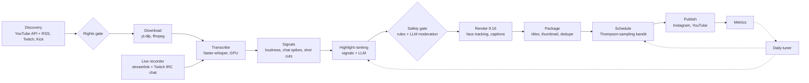

# autoclip

[](https://github.com/bipaulr/autoclip/actions/workflows/tests.yml)

A self-hosted pipeline that turns long streams and videos into vertical short clips. It finds source
videos, transcribes them, ranks candidate moments with audio and chat signals plus an LLM, renders
9:16 clips with captions, and publishes them to Instagram Reels and YouTube Shorts. Then it collects
view metrics. Everything runs in Docker on one PC with a 4 GB GPU, using only free tiers and local
models, so API spend is $0.

It only processes sources it has rights to: creators on an allowlist or paid clipping campaigns the
owner joined. A rights gate in front of every download enforces that.

## Pipeline



| Stage | What it does | Code |
|---|---|---|
| Discovery | Polls allowlisted channels every 20 min and ranks new videos | [`services/discovery.py`](autoclip/services/discovery.py) |
| Rights gate | Rejects anything not on the allowlist or in an active campaign | [`rights.py`](autoclip/rights.py), [`pipeline/gate.py`](autoclip/pipeline/gate.py) |
| Live | Records live streams in chunks and reads chat, so clips post while the stream is still on | [`services/live.py`](autoclip/services/live.py), [`integrations/live.py`](autoclip/integrations/live.py) |
| Transcribe | faster-whisper with word timestamps, CUDA float16 with CPU fallback | [`integrations/transcriber.py`](autoclip/integrations/transcriber.py) |
| Signals | Per-second loudness, chat messages per 10 s, ffmpeg scene cuts | [`pipeline/signals.py`](autoclip/pipeline/signals.py) |
| Highlights | Builds candidate windows, scores them, picks the top ones | [`pipeline/highlights.py`](autoclip/pipeline/highlights.py) |
| Safety gate | Keyword rules, then one batched LLM moderation request per video; holds clips if moderation is down | [`pipeline/gate.py`](autoclip/pipeline/gate.py) |
| Render | Face-tracked or gameplay layout, word-timed captions, hook text, synthesized sound effects, −14 LUFS | [`pipeline/render.py`](autoclip/pipeline/render.py), [`pipeline/style.py`](autoclip/pipeline/style.py) |
| Package | LLM titles and hashtags, thumbnail pick, perceptual-hash duplicate check | [`pipeline/package.py`](autoclip/pipeline/package.py) |
| Decide | Picks account, style, caption density and time slot | [`pipeline/decide.py`](autoclip/pipeline/decide.py) |
| Publish | Instagram Graph API and YouTube Data API uploads from local files | [`publishers/`](autoclip/publishers) |
| Analytics and tuning | Pulls views at fixed ages; a daily job updates the bandit and A/B tests prompts | [`services/analytics.py`](autoclip/services/analytics.py), [`services/tuner.py`](autoclip/services/tuner.py) |

## How moments are ranked

**1. Candidate windows.** Windows of 15 to 60 seconds that always start and end on sentence
boundaries from the transcript. They are seeded from three places:
- loudness peaks: seconds whose RMS level has a z-score of 2 or more against the video's own norm
- chat spikes: 10-second buckets with a message-count z-score of 2 or more and at least 5 messages
- one window about every 30 seconds of speech, so quiet but strong moments still get a chance

Starts snap to a nearby shot cut when one is within 1.5 s. Up to 40 windows go to the LLM, and
windows around chat spikes are always included.

**2. LLM scoring.** Windows go to the LLM in batches of 10, each with its transcript and a one-line
signal summary. The model returns JSON with five 0–10 sub-scores (hook strength, payoff, standalone
clarity, emotion, niche fit), a 0–100 virality score, a title, an on-screen hook and emphasis words.
Output is validated with pydantic and retried once if it is malformed. The prompt is specific to the
niche profile ([`config/profiles/`](config/profiles)).

**3. Blending.** The final score mixes the LLM's judgement with the measured signals, using weights
set per niche:

```
signal = 100 / (1 + e^(-signal_z))          # profile-weighted max z-score of loudness and chat in the window
score  = w_llm * virality + (1 - w_llm) * signal
```

For the `irl_streamer` profile, `w_llm` is 0.55, loudness 0.2 and chat 0.25. Videos with no
signals use the LLM score alone.

**4. Selection.** Non-overlapping windows. Each chat spike first gets its best-scoring window (a moment
the audience reacted to is never dropped for one the model merely liked), then the remaining places
go by score.

**Source ranking.** Discovered videos are queued by

```
rank = (1 + log10(1 + views_per_hour)) * (0.3 + 0.5^(age_hours / 72)) * source_reward * topic_boost
```

where `source_reward` is the source's past post reward relative to the average.

**Scheduling.** A Thompson-sampling bandit with Beta posteriors picks style preset, caption density
and posting hour per account. It explores 30% of the time for the first 50 posts, decaying to 10%.
Hard limits: a daily cap per account, at least 2 hours between posts, and never the same clip on two
accounts of one platform.

## LLM layer

[`integrations/llm.py`](autoclip/integrations/llm.py) puts every provider behind one interface:

- **Fallback chain:** Gemini Flash → Flash-Lite → Gemma (same free key) → a local Ollama model.
- **Failure handling:** a per-minute rate limit gets back-off retries; a used-up daily quota switches
  to the next provider until the date changes; 503 overloads are retried rather than treated as quota.
- **Smaller fallback context:** when the local model takes over mid-video, the highlight batch shrinks
  from 10 windows to 3 to fit its context.
- **Cache:** every response is cached in Postgres by prompt hash, so a re-run never spends quota
  twice. Answers from the local model aren't cached.
- **Moderation:** a flag from the local model is a hold that a stronger model re-checks later, not a
  rejection.

## Stack

- **Languages:** Python 3.12, TypeScript
- **Backend:** FastAPI (27 routes), SQLAlchemy 2 and Alembic (16 tables), Pydantic
- **Background jobs:** Celery and Redis, 17 scheduled jobs (discovery every 20 min, publishing every 2
  min, metrics every 30 min, a daily tuner, self-healing, backups)
- **Media and ML:** ffmpeg, faster-whisper, OpenCV (YuNet face detection), Gemini API, Ollama
- **Dashboard:** Next.js 15 with password-protected admin actions and a kill switch
- **Alerts:** Telegram bot for schedules, failures and campaign submissions
- **Deployment:** Docker Compose with 7 services (postgres, redis, api, worker, live, beat, web)

Every decision the system makes (clip chosen, skipped, held, posted, paused) is written with its
reason to a `decision_log` table and shown on the dashboard.

## Results so far

From the first live run, 12 to 17 Nov 2026:

| | |
|---|---|
| Source videos discovered | 763 |
| Hours of audio transcribed locally | 56 |
| Highlights scored | 161 |
| Clips rendered | 90 |
| Clips published | 22 (16 Instagram, 6 YouTube) |
| Views on published clips | about 4,800 |
| Decisions logged | 7,601 |
| API spend | $0 |

Known gaps from that run:
- **Highlight scoring was the bottleneck.** When the Gemini free quota ran out, the local fallback was
  unreachable from Docker for most of 16–17 Nov, so only 32 of 480 transcribed videos were scored.
- **The ranker has not been measured.** There is no labelled evaluation set.
- **The tuner hasn't run on real data yet.** No post has a reward score, so it has nothing to learn from.

## Not built yet

- OCR of on-screen text, and a frame-level violence classifier (the safety gate checks speech only)
- Model-based audio signals such as laughter detection
- Chat replay for recorded videos (live chat works)

## Run it

You need Docker, and Ollama on the host for the local fallback model.

```bash
cp .env.example .env          # fill in keys, or run: python setup_wizard.py
docker compose up -d --build
```

- API and status page: http://127.0.0.1:8010/status
- Dashboard: http://127.0.0.1:3010

Day-to-day operation is described in [docs/OPERATIONS.md](docs/OPERATIONS.md).

## Tests

```bash
pip install -r requirements.txt
python -m pytest
```

There are 412 tests. Every external API (LLMs, YouTube, Instagram, Twitch, Telegram, the
transcriber) sits behind an interface with a mock, so the suite runs offline against SQLite.
GitHub Actions runs it on every push.

## Layout

```
autoclip/
  pipeline/       highlight ranking, signals, render, gate, packaging, scheduling
  services/       discovery, pipeline orchestration, publishing, analytics, tuner, self-heal
  integrations/   LLM, transcriber, downloader, YouTube, Instagram, Twitch/Kick, Telegram
  publishers/     upload clients
  main.py         FastAPI app
  tasks.py        Celery tasks
migrations/       Alembic
config/           niche profiles, accounts, campaigns
web/              Next.js dashboard
tests/
```
